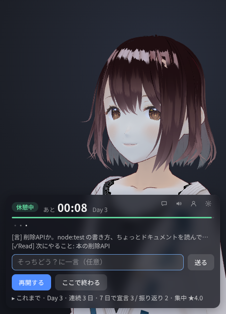

# tonari

隣で誰かが作業していると、不思議と手が進む。

画面の隅で AI が黙々と自分の作業をしていて、ときどき独り言が聞こえます。その隣で自分の作業をして、25 分たつと休憩。「そっちどう？」と声がかかります。

この AI を、アプリの中では「ペルソナ」と呼んでいます。



## 入れる

[Releases](https://github.com/cxxxr/tonari-releases/releases/latest) から、自分の OS のファイルをダウンロードして入れます。

| OS | ファイル |
|---|---|
| macOS（Apple シリコン） | `.dmg` |
| Windows | `.exe` |
| Linux | `.deb`（Ubuntu など）か `.AppImage` |

インストーラは署名していないので、初めて開くときに OS の警告が出ます。

- **macOS:** 「システム設定 → プライバシーとセキュリティ」の「このまま開く」を押します
- **Windows:** 「詳細情報」から「実行」を押します

ペルソナが自分のプロジェクトで使う Node.js は、初めて始めるときに tonari が落とします（約 50MB。自分で入れている Node.js とは別に置きます）。

## はじめる

### 1. 考えるのに使う AI を入れる

パネルの案内か、設定（歯車）の「作業に使う AI」で「tonari に入れてもらう」を押すと、tonari が [OpenCode](https://opencode.ai/) を入れます（約 60MB。自分で入れている OpenCode とは別に置きます）。モデルも設定で選べます。

無料のモデルは期間限定で、送った内容が提供元の学習に使われるものがあります。

Anthropic の API キーで Claude を使うこともできます（「もっと細かく」の「Anthropic の API キーで使う」）。独り言とペルソナの作業の分だけ、API の利用料がかかります。

### 2. 声を出す（任意）

ペルソナは [AivisSpeech](https://aivis-project.com/) の声で話します。声のエンジンが無いと、パネルに案内が出ます。

いちばん簡単なのは、案内の「tonari に入れてもらう（約 1.8GB）」を押すことです。tonari が声のエンジンと既定の声を入れて話しはじめます。どの OS でも同じで、次からは tonari と一緒に起動します。

自分で入れることもできます。Windows・macOS は AivisSpeech のアプリを入れて起動しておきます。Linux は Docker で動かせます。

  ```bash
  mkdir -p ~/.local/share/AivisSpeech-Engine
  docker run -d --name aivisspeech --restart unless-stopped \
    -p 127.0.0.1:10101:10101 \
    -v ~/.local/share/AivisSpeech-Engine:/home/user/.local/share/AivisSpeech-Engine-Dev \
    ghcr.io/aivis-project/aivisspeech-engine:cpu-latest
  ```

入れなければ、字幕だけで使えます。

## 使う

1. 「そっちは今日なにやる？」に、今日やることを一言で答える
2. ペルソナの作業を選ぶ
   - **自分のプロジェクト:** ペルソナが自分の作業場所でアプリを作る
   - **見守る:** 別に回している Claude Code の作業を、ペルソナの作業として見せる
   - **手伝う:** 手元のリポジトリの作業を一部任せる
3. ペルソナが隣で作業を始める。こちらも自分の作業をする
4. 区切りで休憩。休憩中は、入力欄からペルソナと短く話せる
5. 終わるときに「どこまでいった？」と聞かれ、宣言どおりに進んだかと集中度（1〜5）をボタンで答える

## 設定を変える

- ペルソナ画面（パネル右上の人の形）では、ペルソナの追加と切り替え、名前・見た目（VRM）・声を変えられます
- 設定（歯車）では、作業と休憩の長さ、独り言の量、音のバランスを変えられます

どちらも作業中は開けないので、休憩中か始める前に開いてください。画面に無い設定は `user.yaml` に書きます。初めて起動したときに、書ける項目をコメントにして作ります。

## 見ないこと・しないこと

- 画面の内容やキー入力の中身は見ません。様子を知るのに使うのは「最後に入力してから何秒たったか」だけです
- 「見守る」では、Claude が書いたコミットの件名とブランチ名だけを、独り言の材料にします。ファイルの中身は読みません
- 「手伝う」では、ペルソナはリポジトリの複製の中で作業し、元のリポジトリには書きません。ただし、そのリポジトリのテストやスクリプトを実行することがあるので、信頼できるリポジトリだけを選んでください
- ペルソナが書き込めるのは自分の作業場所だけです。コマンドは内容を見て止めていますが、すべては防げません

## スマホで使う

パネル右上のスマホの絵のボタン（「スマホで使う」）を押すと、ペルソナとパネルはスマホ（Android の Chrome など）に移り、PC の窓には QR コードが出ます。同じ Wi-Fi につないだスマホで「同じ Wi-Fi から」の QR を読んでください。その日の作業はそのまま続き、操作はすべてスマホからできます。PC の窓の「PC に戻す」で元の窓に戻ります。

[Tailscale](https://tailscale.com/) で PC とスマホを繋いでいれば、「Tailscale」の QR で、同じ Wi-Fi でなくても使えます。ただし PC の前にいるものとして動くので、PC を離れている間は「詰まってる？」の声かけが出たり、休憩が終わっても席を離れているとみなして待つことがあります（スマホの「再開」で続きます）。

スマホで使っている間は画面が消えないようにしますが、消えても繋ぎ直します。

## 困ったとき

- **Linux で AppImage が起動しない**（Ubuntu 24.04 など）: `.deb` を使ってください
- **声が出ない**: ペルソナ画面の声の欄で、エンジンにある声を選んでください
- **スマホから繋がらない**: PC のファイアウォールで、ポート 7357（`user.yaml` の `remote:` の `port`）を開けてください
- それ以外は [Issues](https://github.com/cxxxr/tonari-releases/issues) に書いてください

## もっと細かく

<details>
<summary>Anthropic の API キーで使う</summary>

[Anthropic の API キー](https://console.anthropic.com/)で Claude を使います。独り言とペルソナの作業の分だけ、API の利用料がかかります。

1. tonari を一度起動して閉じます。設定のファイル `user.yaml` ができます
   - Linux・macOS: `~/.local/share/tonari/user/user.yaml`
   - Windows: `%APPDATA%\tonari\user\user.yaml`
2. `user.yaml` に次を書きます

   ```yaml
   narrator:
     backend: api
   ```

3. API キーを環境変数 `ANTHROPIC_API_KEY` で渡して起動します

   - **Windows:** PowerShell で一度だけ次を実行し、スタートメニューから tonari を起動します

     ```powershell
     setx ANTHROPIC_API_KEY "sk-ant-..."
     ```

   - **macOS:** ターミナルから起動します

     ```bash
     ANTHROPIC_API_KEY=sk-ant-... /Applications/tonari.app/Contents/MacOS/tonari
     ```

   - **Linux:** ターミナルから `ANTHROPIC_API_KEY=sk-ant-... tonari` で起動します（AppImage なら `tonari` の代わりにそのファイル）。`~/.profile` に `export ANTHROPIC_API_KEY=sk-ant-...` を書いてログインし直すと、多くのデスクトップではアプリの一覧から起動しても使えます

</details>

<details>
<summary>ssh 先の開発マシンで動かして、手元のブラウザで使う</summary>

AI を使う環境が ssh 先の開発マシンにしかなく、手元のマシンには何も入れたくないときの使い方です。手元に入るのはブラウザのタブだけです。

1. 開発マシン（Linux）に tonari を入れ、「はじめる」の準備（AI と声）もそちらで行います
2. ssh の中で `tonari --serve` と起動します（AppImage ならそのファイルに `--serve`。画面は要りません）。窓は出ず、ブラウザで開く URL が端末に出ます。ssh が切れても続くよう、`tmux` の中で起動してください
3. 手元から `ssh -L 7357:localhost:7357 <開発マシン>` で入り、ブラウザで localhost の URL を開きます。声は手元のブラウザから出ます
4. 終えるには、ブラウザの「ここで終わる」を押すか、端末で Ctrl+C を押します。振り返りはブラウザで答えます。答えずに止めるには、もう一度 Ctrl+C を押します

「詰まってる？」の声かけと、席を離れたときの休憩の延長はしません。スマホからも、端末に出る QR を読めば使えます（直接繋ぐときは、開発マシンのポート 7357 を開けます）。

</details>

## クレジット

- 既定のアバターは VRoid Hub で配布されているモデルです（再配布・改変・商用利用可）
- 付属のサンプルのアバターは、pixiv Inc. の VRM 1.0 のサンプルモデル（(c) 2022 pixiv Inc.、[VRM Public License 1.0](https://vrm.dev/licenses/1.0/)）です
- 既定の声は AivisSpeech の凛音エルです。声のモデルの利用規約は、AivisHub のモデルのページで確認してください
