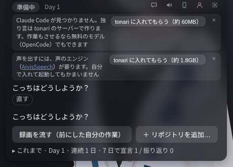
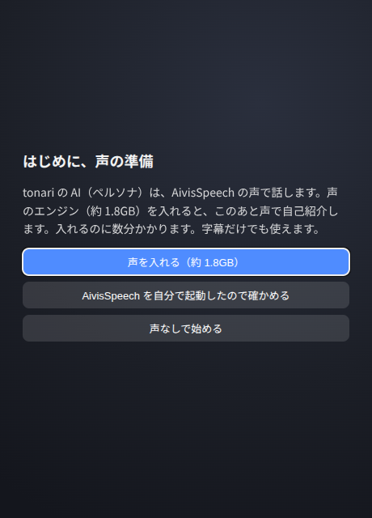
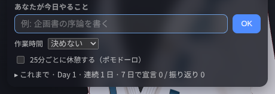
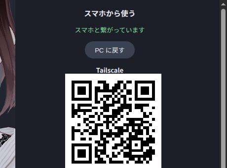
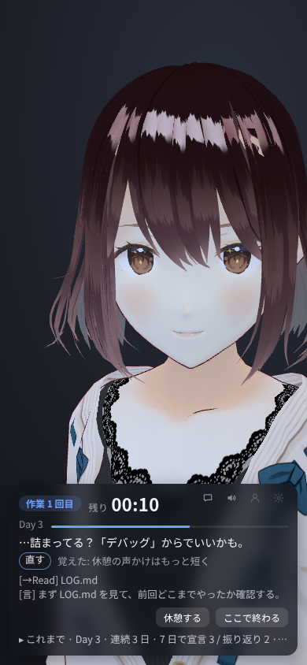

# tonari

隣で誰かが作業していると、不思議と手が進む。

画面の隅で AI が黙々と自分の作業をしていて、ときどき独り言が聞こえます。その隣で自分の作業をして、休みたくなったら休憩。そのあいだは AI も手を止めます。作業を終えたら、少し雑談もできます。

この AI を、アプリの中では「ペルソナ」と呼んでいます。


## 入れる

[Releases](https://github.com/cxxxr/tonari-releases/releases/latest) から、自分の OS のファイルをダウンロードして入れます。

| OS | ファイル |
|---|---|
| macOS（Apple シリコン） | `.dmg` |
| Windows | `.exe` |
| Linux | `.deb`（Ubuntu など）か `.AppImage` |

インストーラは署名していないので、初めて開くときに OS の警告が出ます。

- **macOS:** 「システム設定 → プライバシーとセキュリティ」の「このまま開く」を押します
- **Windows:** 「詳細情報」から「実行」を押します

ペルソナが自分のプロジェクトで使う Node.js は、初めて始めるときに tonari が落とします（約 50MB。自分で入れている Node.js とは別に置きます）。

## はじめる

独り言と休憩の会話を作るサーバーは、14 日間無料で試せます。続けて使うなら月額 800 円（税込）です。パネルか設定の「続けて使う」から申し込めます。申し込まなくても、「（収録）」の付いたボタンと「見守る」は使え、独り言は決まった文になります。

### 1. 考えるのに使う AI を入れる（任意）

入れなくても始められます。使える AI が無いときは、独り言と休憩の会話を tonari のサーバーで作ります。ペルソナの作業は「（収録）」の付いたボタンか「見守る」になります。インストーラで入れた版は、Claude Code を使いません。

ペルソナに本当に作業もさせるなら、設定（歯車）の「作業に使う AI」で、次のどちらかを選びます。作業の選択に出る「＋ ペルソナに作業もさせる…」からも開けます。

- **OpenCode:** 「tonari に入れてもらう」を押すと、tonari が [OpenCode](https://opencode.ai/) を入れます（約 60MB）。自分で入れている OpenCode とは別に置きます。無料のモデルもあります
- **Codex:** 先に [Codex CLI](https://developers.openai.com/codex/cli/) を入れ、端末で `codex login` を実行してから、tonari を起動し直します。使うのはその Codex の利用枠か API の費用です



無料のモデルは期間限定で、送った内容が提供元の学習に使われるものがあります。

Anthropic の API キーで、独り言と休憩の会話を Claude で作ることもできます（「もっと細かく」の「Anthropic の API キーで使う」）。

### 2. 声を出す（任意）

ペルソナは [AivisSpeech](https://aivis-project.com/) の声で話します。声のエンジンが無いと、パネルに案内が出ます。

いちばん簡単なのは、初めて起動したときの「はじめに、声の準備」で「声を入れる（約 1.8GB）」を押すことです。あとから入れるなら、パネルの案内の「tonari に入れてもらう」を押します。tonari が声のエンジンと既定の声を入れて話しはじめます。どの OS でも同じで、次からは tonari と一緒に起動します。



自分で入れることもできます。Windows・macOS は AivisSpeech のアプリを入れて起動しておきます。Linux は Docker で動かせます。

  ```bash
  mkdir -p ~/.local/share/AivisSpeech-Engine
  docker run -d --name aivisspeech --restart unless-stopped \
    -p 127.0.0.1:10101:10101 \
    -v ~/.local/share/AivisSpeech-Engine:/home/user/.local/share/AivisSpeech-Engine-Dev \
    ghcr.io/aivis-project/aivisspeech-engine:cpu-latest
  ```

入れなければ、字幕だけで使えます。

## 使う

会話だけしたいときは、開始の入力欄の「ちょっと話す」を押します。「おしまい」で元の入力欄に戻り、書きかけも残ります。作業の準備や振り返りはありません。

1. 「そっちは今日なにやる？」に、今日やることを一言で答える。答える前に、入力欄の下で作業時間（決めない・30 分〜2 時間）と、25 分ごとに休憩するか（ポモドーロ）を選べる。次の回も同じになる。名前をまだ伝えていなければ、ペルソナが聞く
2. ペルソナの作業を選ぶ
   - **自分のプロジェクト:** ペルソナが自分の作業場所でアプリを作る（AI を使えるときだけ）
   - **「（収録）」の付いたボタン:** 前に収録した作業を、そのままの順でなぞる。「ほんだな」を進める（収録） のように出る（録画があるときだけ）。ペルソナは考えず、独り言だけ作る
   - **見守る:** 別に回している Claude Code の作業を、ペルソナの作業として見せる
   - **手伝う:** 手元のリポジトリの作業を一部任せる（AI を使えるときだけ）
3. ペルソナが隣で作業を始める。こちらも自分の作業をする
4. 休みたくなったら「休憩する」を押す。休憩中は、入力欄からペルソナと短く話せる。休憩した時間と作業時間が表示され、「再開する」を押すと作業に戻る。ポモドーロなら、休憩は決まった長さで終わる
5. 作業時間が来ると、ペルソナが「おしまいにする / もう少しやる」を聞く。もう少しやるときと、作業時間を決めていないときは、「ここで終わる」で終える
6. 「どこまでいった？」と聞かれ、宣言どおりに進んだかと集中度（1〜5）をボタンで答える。そのあとは雑談の時間で、「おしまい」を押すか、席を離れて 5 分たつまで話せる



新しく作ったペルソナには、作り手が前に収録した作業の録画が入っていて、初日からなぞれます。独り言と休憩中の会話は、そのときのペルソナがその場で考えて話します。

窓の × で終えるときも、締めの一言のあとに終わりの画面が出ます。「閉じる」でアプリを終了します。

## 設定を変える

- ペルソナ画面（パネル右上の人の形）では、ペルソナの追加と切り替え、名前・見た目（VRM）・声を変えられます
- 設定（歯車）では、作業の区切りとポモドーロの休憩の長さや、独り言の量を変えられます
- 音のバランスとペルソナの打つ速さも、設定（歯車）で変えられます
- あなたの名前・名前の読み・ペルソナからの呼び方も、設定（歯車）で変えられます。呼び方は、本人の希望を優先しながら AI が考えます
- 作業に使う AI とそのモデルも、設定（歯車）で選べます。その日の作業を始めたあとに変えたら、次に起動したときからです

どちらも作業中に開けます。ペルソナの切り替えだけは、始める前にしてください。時間の設定は、次に起動したときから効きます。画面に無い設定は `user.yaml` に書きます。初めて起動したときに、書ける項目をコメントにして作ります。

ペルソナが走らせたテストなどがメモリを使いすぎたときは、そのプロセスだけを止めます。上限は `user.yaml` の `agent:` の `memory_limit_mb`（MB。既定は 8GB と使えるメモリの半分の小さいほう。0 で止めません）。

設定の「お支払い」から、支払いの管理と別の PC への引き継ぎができます。1 つの申し込みで PC 2 台まで使えます。

## 見ないこと・しないこと

- 画面の内容やキー入力の中身は見ません。様子を知るのに使うのは「最後に入力してから何秒たったか」だけです
- 「見守る」では、Claude が書いたコミットの件名とブランチ名だけを、独り言の材料にします。ファイルの中身は読みません
- 「手伝う」では、ペルソナはリポジトリの複製の中で作業し、元のリポジトリには書きません。ただし、そのリポジトリのテストやスクリプトを実行することがあるので、信頼できるリポジトリだけを選んでください
- ペルソナが書き込めるのは自分の作業場所だけです。コマンドは内容を見て止めていますが、すべては防げません
- 使える AI が無いときと Codex を使うときは、独り言の材料を tonari のサーバーに送り、サーバーが AWS の Bedrock で独り言と休憩の会話を作ります。材料は、今日と前の日の宣言と振り返り、休憩中と雑談での返事、あなたの名前と呼び方、ペルソナの作業の出来事、セリフの直し、ペルソナの性格です（「見守る」ではコミットの件名とブランチ名も）
- tonari のサーバーは、本文と IP アドレスを残しません。残すのは、無記名のトークンのハッシュ、日ごとの回数、送信元を見分けるために IP アドレスから作った値です。月額プランの申し込みには Stripe の顧客・申し込みの番号と状態も結びます。名前・メールアドレス・カード情報は Stripe が持ちます。アカウントは要りません
- 起動時に 1 日 1 回、新しい版があるかを GitHub に聞き、出ていればパネルに一言知らせます。利用者を見分けるものは送りません。`user.yaml` に `update_notice: false` と書けば聞きません

## スマホで使う

パネル右上のスマホの絵のボタン（「スマホで使う」）を押すと、ペルソナとパネルはスマホ（Android の Chrome など）に移り、PC の窓には QR コードが出ます。同じ Wi-Fi につないだスマホで「同じ Wi-Fi から」の QR を読んでください。その日の作業はそのまま続き、操作はすべてスマホからできます。PC の窓の「PC に戻す」で元の窓に戻ります。

 

[Tailscale](https://tailscale.com/) で PC とスマホを繋いでいれば、「Tailscale」の QR で、同じ Wi-Fi でなくても使えます。

スマホで使っている間も、PC の前にいるものとして動きます。PC を離れていると「詰まってる？」の声かけが出たり、ポモドーロの休憩が終わっても待ったりします（スマホの「再開」で続きます）。

スマホで使っている間は画面が消えないようにしますが、消えても繋ぎ直します。

## 困ったとき

- **Linux で AppImage が起動しない**（Ubuntu 24.04 など）: `.deb` を使ってください
- **AI を使わずにいて、独り言が同じ文ばかりになる**: お試しが終わったか、1 日の上限に達しています。お試しの状態は設定の「お支払い」で確認できます。1 日の上限は次の日（日本時間の朝 9 時）に戻ります
- **声が出ない**: ペルソナ画面の声の欄で、エンジンにある声を選んでください
- **スマホから繋がらない**: PC のファイアウォールで、ポート 7357（`user.yaml` の `remote:` の `port`）を開けてください
- それ以外は [Issues](https://github.com/cxxxr/tonari-releases/issues) に書いてください

## もっと細かく

<details>
<summary>Anthropic の API キーで使う</summary>

[Anthropic の API キー](https://console.anthropic.com/)で、独り言と休憩の会話を Claude で作ります。その分の API の利用料がかかります。ペルソナの作業には使いません（作業は OpenCode か Codex）。

1. tonari を一度起動して閉じます。設定のファイル `user.yaml` ができます
   - Linux・macOS: `~/.local/share/tonari/user/user.yaml`
   - Windows: `%APPDATA%\tonari\user\user.yaml`
2. `user.yaml` に次を書きます

   ```yaml
   narrator:
     backend: api
   ```

3. API キーを環境変数 `ANTHROPIC_API_KEY` で渡して起動します

   - **Windows:** PowerShell で一度だけ次を実行し、スタートメニューから tonari を起動します

     ```powershell
     setx ANTHROPIC_API_KEY "sk-ant-..."
     ```

   - **macOS:** ターミナルから起動します

     ```bash
     ANTHROPIC_API_KEY=sk-ant-... /Applications/tonari.app/Contents/MacOS/tonari
     ```

   - **Linux:** ターミナルから `ANTHROPIC_API_KEY=sk-ant-... tonari` で起動します（AppImage なら `tonari` の代わりにそのファイル）。`~/.profile` に `export ANTHROPIC_API_KEY=sk-ant-...` を書いてログインし直すと、多くのデスクトップではアプリの一覧から起動しても使えます

</details>

<details>
<summary>ssh 先の開発マシンで動かして、手元のブラウザで使う</summary>

AI を使う環境が ssh 先の開発マシンにしかなく、手元のマシンには何も入れたくないときの使い方です。手元に入るのはブラウザのタブだけです。

1. 開発マシン（Linux）に tonari を入れ、「はじめる」の準備（AI と声）もそちらで行います
2. ssh の中で `tonari --serve` と起動します（AppImage ならそのファイルに `--serve`。画面は要りません）。窓は出ず、ブラウザで開く URL が端末に出ます。ssh が切れても続くよう、`tmux` の中で起動してください
3. 手元から `ssh -L 7357:localhost:7357 <開発マシン>` で入り、ブラウザで localhost の URL を開きます。声は手元のブラウザから出ます
4. 終えるには、ブラウザの「ここで終わる」を押すか、端末で Ctrl+C を押します。振り返りと雑談、終わりの画面の「閉じる」はブラウザで操作します。答えずに止めるには、もう一度 Ctrl+C を押します

「詰まってる？」の声かけと、席を離れたかの判定（ポモドーロの休憩の延長、休憩中に戻ってきたら再開すること、雑談を終えること）はしません。スマホからも、端末に出る QR を読めば使えます（直接繋ぐときは、開発マシンのポート 7357 を開けます）。

</details>

## クレジット

- 既定のアバターは VRoid Hub で配布されているモデルです（再配布・改変・商用利用可）
- 付属のサンプルのアバターは、pixiv Inc. の VRM 1.0 のサンプルモデル（(c) 2022 pixiv Inc.、[VRM Public License 1.0](https://vrm.dev/licenses/1.0/)）です
- 既定の声は AivisSpeech の凛音エルです。声のモデルの利用規約は、AivisHub のモデルのページで確認してください
- ほかの同梱物と、使っているソフトウェアのライセンスは、各版の Releases に添えた `THIRD-PARTY-NOTICES.md` にあります（tonari の中にも入っています）
- 利用条件は [LICENSE.md](LICENSE.md) です。入れるのは無料で、個人でも仕事でも使えます。独り言と会話を作る tonari のサーバーは、14 日間の無料のお試しのあと月額 800 円です。ほかの人に勧めるときは、tonari を配らずに、このページへの案内にしてください
